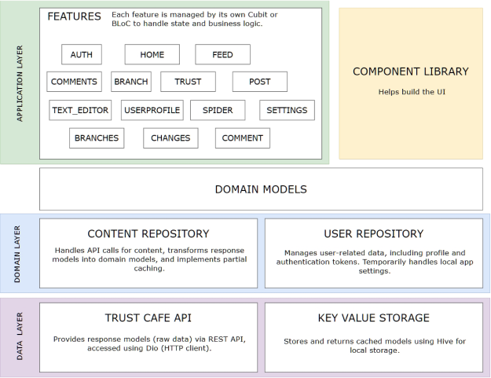
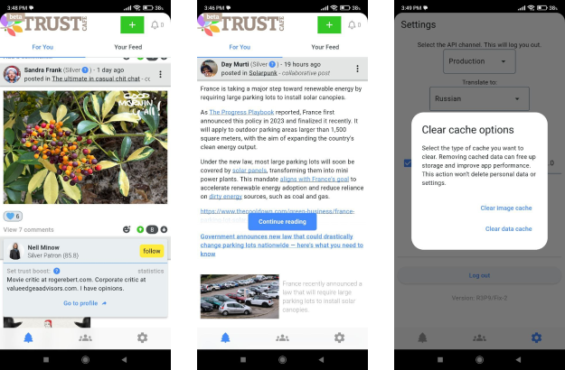

# Trust Cafe Mobile (TCM) Client

  

## Project retired

According to [this post](https://www.trustcafe.io/post/1786640101-ef2b9e3e), a "decent mobile app" is already in the works, so I am retiring this project. I wish Simon and Fin the very best of luck with the new app.

Even though I could rewrite the whole thing in a much better state within a few days on a personal Claude subscription (and probably within a day on the plan I use at work), it was great fun working on this app: reverse engineering the API (which I liked to call reconnaissance), finding a workaround to allow authorization, watching for feature requests and designing them, and many other things along the way.

Sorry I never caught up with the functionality of the website, even though it stayed at roughly the same spot for the entire lifetime of the app.

Thanks for giving it a try and for the valuable feedback.

## Overview
Trust Cafe Mobile is a Flutter-based mobile client for the [Trust Cafe](https://www.trustcafe.io/en) platform, an aspiring social media network created to combat misinformation and foster community-led moderation. Dedicated to supporting meaningful discussions in a non-toxic, fact-based environment, this app was voluntarily developed to enhance user accessibility while introducing unique features not available on the website.

## Architecture breakdown
The app relies on several internal packages. Their purposes are illustrated in this diagram, along with the architecture breakdown.

  

## Future Goals
- Expand app functionality to match or exceed the web platform.
- Set up the CI/CD pipeline
- Write more automated tests
- Release on popular distribution platforms, such as the App Store and Google Play

## Screenshots

  

## Notes

- Having written most of the code before I had any commercial experience (and I still don’t have commercial experience with Flutter), I have to admit that this repository’s code stinks. Starting with the code style (hello, auto-formatting) and ending with some architectural decisions.

- The “Architecture breakdown” section is a bit outdated. Features are no longer separated into their own packages, as I learned the hard way how difficult it is to maintain and update shared packages. By moving them into the core module, I was hoping the static analyzer would work more effectively, but that didn’t help much either.

- As for the development flow, I tried to apply a strategy I learned at work. It may not be entirely appropriate for a mobile application, but it did improve organization. The basic idea is that the `main` branch always contains the most recent production-ready code. New branches are created from `main` for each task, and each `task branch` must be named after the corresponding ***`issue`*** it addresses. Commits to a `task branch` should include the branch name. Once a task is complete, it can be merged into the `demo` branch, which is currently used to observe behavior alongside other tasks. This repository has CI pipelines configured for both the `main` and `demo` branches.